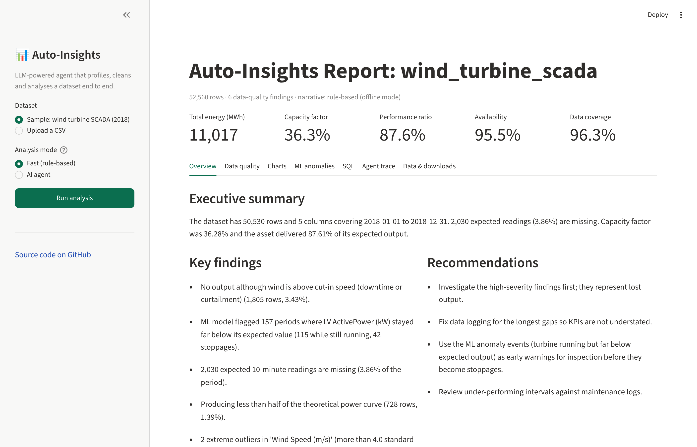
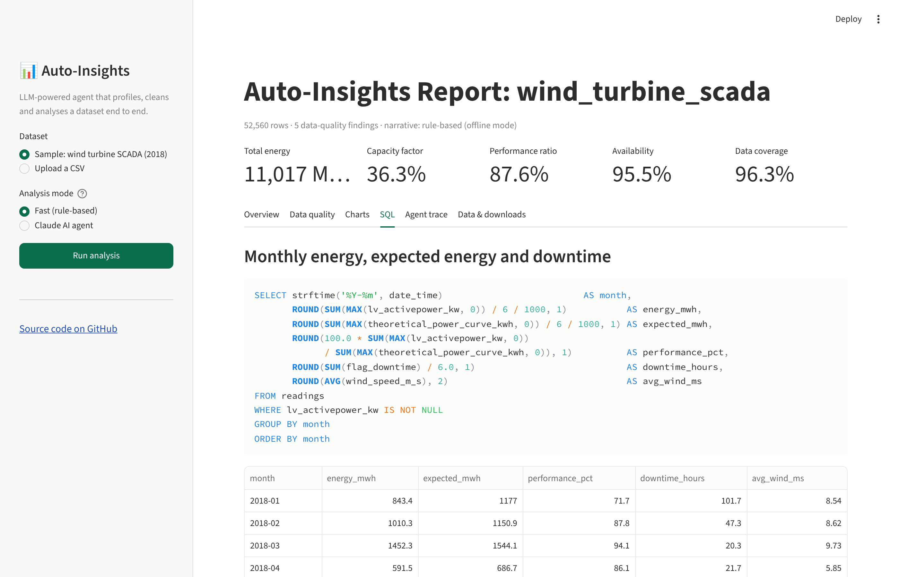
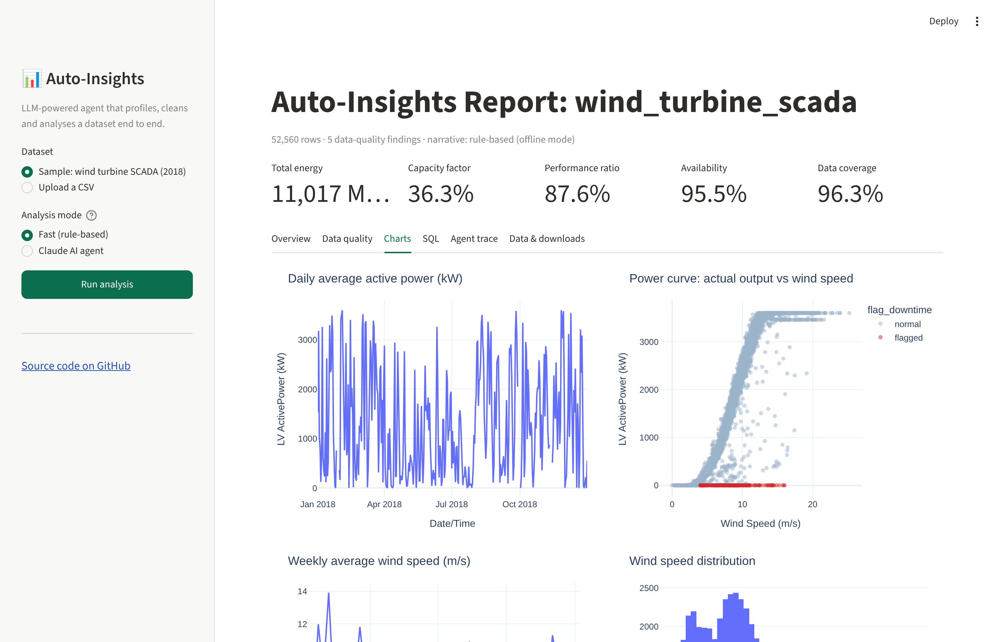

# Auto-Insights AI Agent


An LLM-powered agent that analyses a dataset end to end without a human in the loop. It profiles the data, handles missing values, flags inconsistencies, runs exploratory data analysis and SQL KPI queries, and produces an interactive dashboard and report.

The demo runs on **real wind turbine SCADA data**: one year of 10-minute readings from a 3.6 MW turbine. This is the kind of operational data used to monitor wind fleets.

**▶ Live dashboard:** _link added after deployment (see [Deploy the dashboard](#deploy-the-dashboard))_



## What it does

| Step | What happens |
|---|---|
| **Profile** | Detects column types, the timestamp column, the sampling interval and the time range |
| **Missing values** | Finds empty cells *and* missing timestamps. It fills short gaps by time interpolation and leaves long outages empty, so no data is invented |
| **Inconsistencies** | Runs generic checks (duplicates, negatives, z-score outliers, stuck sensors), then the agent writes **domain rules** such as "no output although wind is above cut-in speed" |
| **EDA** | Distributions, skew, IQR outliers, strongest correlations |
| **SQL** | Loads the cleaned data into a SQLite database. KPIs are broken down with SQL (monthly energy and downtime, losses by wind band, worst days), and the agent can write its own queries |
| **KPIs** | Energy, capacity factor, performance ratio vs. expected output, availability, under-performing intervals |
| **Trends** | Monthly, weekly or daily aggregation with best/worst periods and the linear trend |
| **Deliverables** | Interactive Streamlit dashboard, standalone HTML dashboard, Markdown report, Excel workbook (ready for Power BI or Excel), cleaned CSV |

## How the agent works

```
           ┌────────────────────────────────────────────────┐
 dataset → │ LLM (Claude or Gemini) decides the next step   │ ← system prompt: "act like a senior analyst"
           └───────────────┬────────────────────────────────┘
                           │ tool call (JSON)
                           ▼
           ┌────────────────────────────────────────────────┐
           │ Python tools: pandas (profile, clean, rules,   │
           │ KPIs, trends) and SQLite (run_sql)             │
           └───────────────┬────────────────────────────────┘
                           │ tool result (JSON numbers)
                           └──────── back to Claude ─── repeat until write_report
```

* **Two LLM providers, one loop:** Anthropic Claude (`agent.py`) or Google Gemini (`agent_gemini.py`, free tier). Both use the same tools and the same prompt, and the app uses whichever key you provide.
* **The LLM decides, the code calculates.** The LLM chooses which tools to run, writes domain rules and SQL, and writes the narrative. Every number comes from pandas or SQLite, so the model cannot make up statistics.
* **Hand-written tool-use loop** (`auto_insights/agent.py`), with no framework, so each step is visible and testable. The dashboard's *Agent trace* tab shows every tool call.
* **Safe by design:** pandas rules allow only column names, numbers and comparison operators. SQL runs under a SQLite authorizer that permits reading only, so `DROP`, `DELETE`, `ATTACH` and multi-statement queries are rejected (see the tests).
* **Error recovery:** if a tool fails (for example, a wrong column name or bad SQL), the error goes back to the LLM as a tool result and it corrects itself.
* **Fast mode:** without an API key, the same tools run in a fixed order with a rule-based narrative. The project always runs, and the tests need no key.

## Results on the wind turbine dataset

| KPI | Value |
|---|---|
| Energy produced | **11,017 MWh** |
| Capacity factor | **36.3 %** |
| Performance ratio (actual vs. theoretical power curve) | **87.6 %** (12.4 % of expected output lost) |
| Availability (producing when wind allowed) | **95.5 %** |
| Data coverage | **96.3 %** (2,030 missing 10-minute readings) |

What the analysis found:
* **1,805 intervals with zero output even though wind was ≥ 4 m/s.** These look like downtime or curtailment, and they are the biggest source of lost energy.
* **Downtime is a winter problem (SQL):** January had 101.7 h and December 81 h of downtime, against 2–8 h a month in summer. January's performance ratio fell to 71.7 %. This pattern is consistent with icing or winter maintenance.
* **Most energy is lost at 9–12 m/s wind (SQL)**: 774 MWh, more than any other wind band.
* Worst single day: 2018-01-24, with 61.7 MWh lost and 22.3 h of downtime.
* 728 intervals producing less than half of the theoretical power curve, and 57 negative power readings.

Full output: [`docs/sample_report.md`](docs/sample_report.md)

<p>


</p>

## Run it on your computer

```bash
git clone https://github.com/malihashaik68/auto-insights-ai-agent.git
cd auto-insights-ai-agent
python -m venv .venv && source .venv/bin/activate
pip install -r requirements.txt
python data/download_data.py
```

Interactive dashboard (opens in your browser at http://localhost:8501):

```bash
streamlit run app.py
```

Command line, fast mode (no API key needed):

```bash
python -m auto_insights data/wind_turbine_scada.csv --preset wind_turbine
```

Command line, AI agent (free Gemini key from https://aistudio.google.com/apikey, or an Anthropic key):

```bash
cp .env.example .env        # then paste your key into .env
python -m auto_insights data/wind_turbine_scada.csv --goal "Where is this turbine losing energy?"
```

It works on any CSV, from the dashboard (*Upload a CSV*) or the command line:

```bash
python -m auto_insights path/to/sales.csv --goal "Why did revenue drop in Q3?"
```

## Deploy the dashboard

The app runs free on [Streamlit Community Cloud](https://share.streamlit.io):

1. Sign in with GitHub, click **Create app**, then **Deploy a public app from GitHub**.
2. Repository `malihashaik68/auto-insights-ai-agent`, branch `main`, main file `app.py`.
3. Optional, to enable the AI agent: under **Advanced settings → Secrets**, paste the contents of `.streamlit/secrets.toml.example` with your own values (a free Gemini key works). Visitors who enter the access code can then run the agent on your key; anyone else can paste their own key.

## Tests

```bash
pytest -q
```

22 tests cover profiling, gap detection and filling, rule checks (including rejecting injected code), read-only SQL, a cross-check that SQL monthly energy matches the pandas KPI, the full pipeline, and both agent loops (Claude and Gemini) using fake clients. GitHub Actions runs them on every push.

## Project structure

```
app.py                  Streamlit dashboard
auto_insights/
  agent.py              Claude tool-use loop, tool definitions, system prompt
  agent_gemini.py       the same loop on Google Gemini
  data_tools.py         pandas analysis tools (the numbers)
  sql_tools.py          read-only SQLite layer
  offline.py            fast rule-based pipeline + wind turbine preset (rules, SQL)
  report.py             HTML dashboard, Markdown report, Excel workbook
  __main__.py           command-line interface
data/download_data.py   fetches the public dataset
tests/                  pytest suite
```

## Tech stack

Python · Anthropic Claude API & Google Gemini API (tool use / function calling) · SQL (SQLite) · pandas · NumPy · Streamlit · Plotly · openpyxl (Excel / Power BI export) · pytest · GitHub Actions

## Data source

"Wind Turbine Scada Dataset": a turbine in Turkey, 2018, 10-minute SCADA readings (active power, wind speed, theoretical power curve, wind direction). It was originally published on Kaggle; this project downloads a public GitHub mirror.
